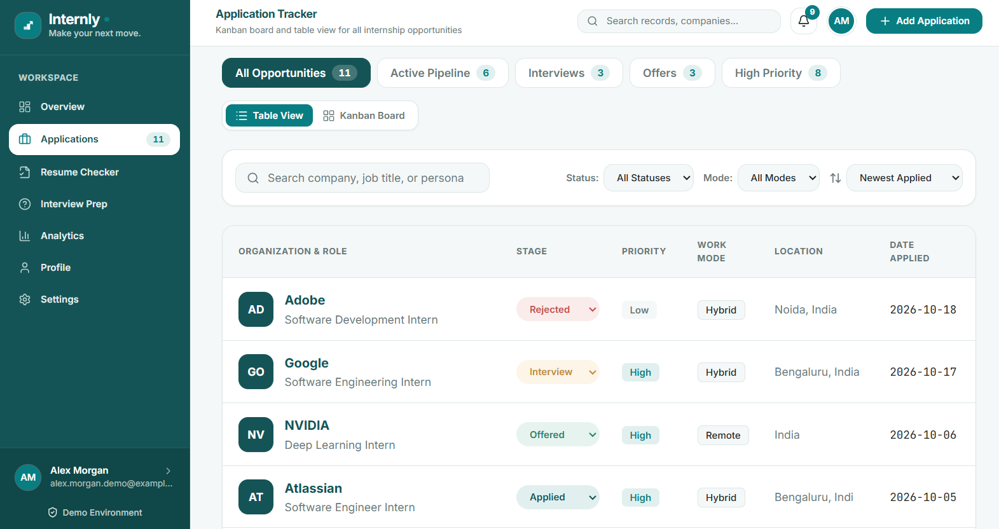
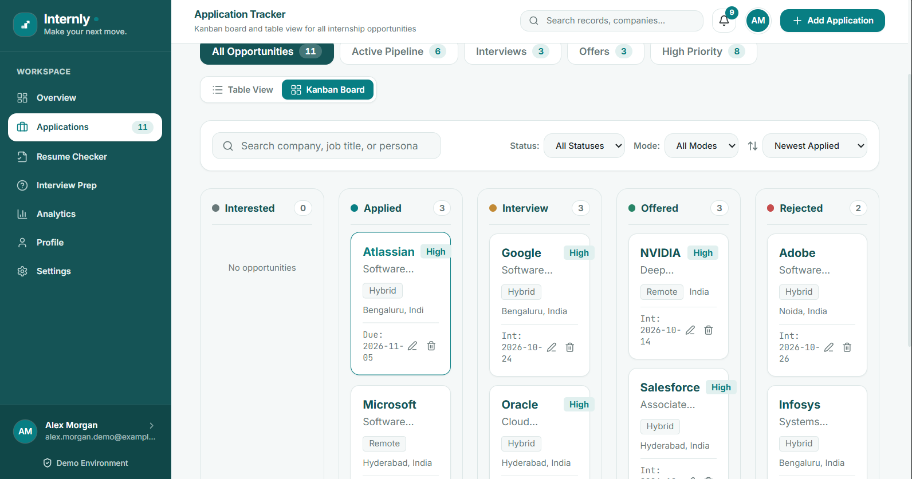
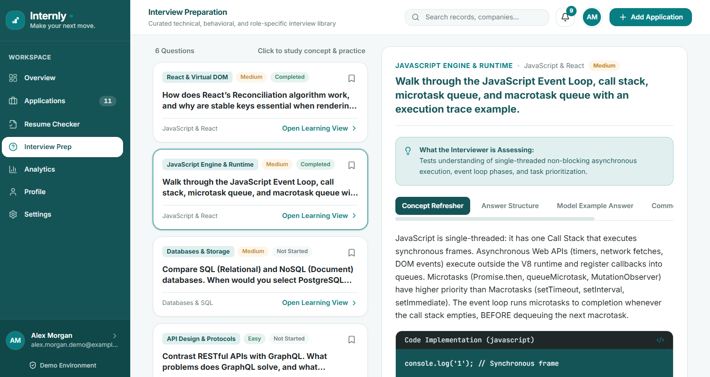
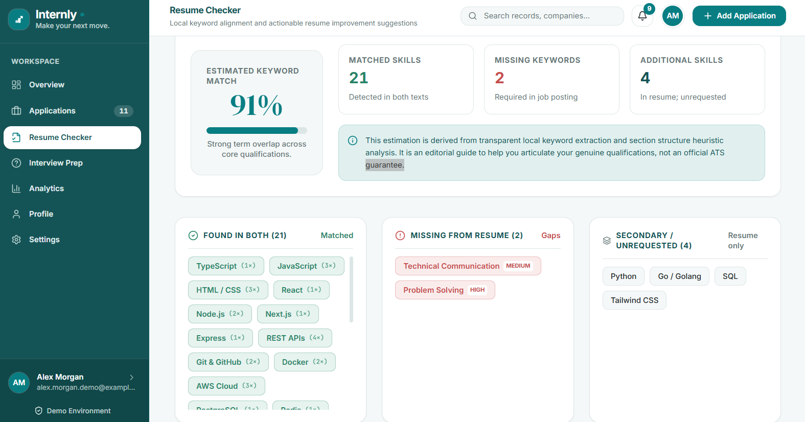
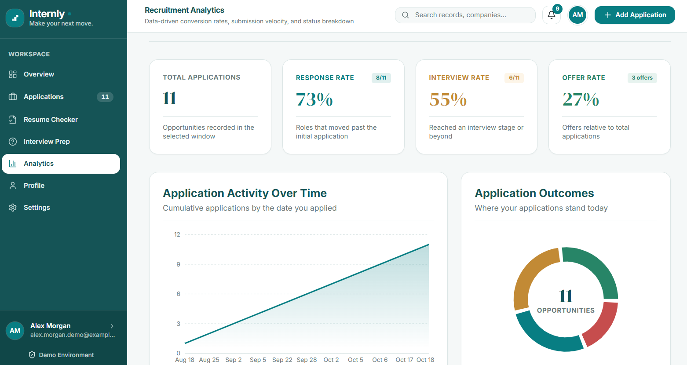

# Internly

**Internly** is a full-stack internship and career management platform. Track applications, check your resume against a job description, prepare for interviews, and see your progress in one place.

Built with React, Express, and MongoDB Atlas.


## Features

- **Secure accounts**: registration and login with bcrypt-hashed passwords and an HttpOnly cookie session
- **Application tracker**: add, edit, delete, search, filter and sort applications, with table and Kanban views and an activity timeline for each one
- **Dashboard**: pipeline summary, upcoming deadlines and recent activity
- **Resume checker**: keyword alignment between your resume and a job description, with suggestions and a checklist. The analysis runs in your browser, and only the saved report is stored
- **Interview prep**: a curated question library with your own status, bookmarks, notes and practice answers, plus custom questions, a study plan, learning resources and mock interview sessions
- **Analytics**: response, interview and offer rates, charts, and interview-prep progress
- **Profile and settings**: career profile, photo upload and tracker preferences
- **Per-user data**: every record belongs to one account and is never visible to others

## Screenshots

| Applications | Kanban |
| --- | --- |
|  |  |

| Interview prep | Resume checker |
| --- | --- |
|  |  |

| Analytics | Profile |
| --- | --- |
|  |  |

## Tech stack

**Frontend:** React 19, TypeScript, Vite, Tailwind CSS v4, Recharts, Lucide icons

**Backend:** Node.js, Express 5, MongoDB Atlas with Mongoose

**Security:** bcrypt password hashing, JWT in an HttpOnly cookie, Zod input validation, Helmet security headers, rate limiting on login and registration, and ownership checks on every query

## Project structure

```
Internly/
├── src/                 # React frontend
│   ├── components/      # Pages, layout and modals
│   ├── services/        # API client and service modules
│   ├── hooks/           # Data hooks
│   ├── utils/           # Analytics, date and resume-matching helpers
│   └── data/            # Interview question library
└── server/              # Express API
    └── src/
        ├── config/      # Database connection
        ├── controllers/
        ├── middleware/  # Auth protection
        ├── models/      # Mongoose models
        ├── routes/
        └── utils/       # Tokens and validation
```

## Getting started

### Prerequisites

- Node.js 20.19 or newer
- A free [MongoDB Atlas](https://www.mongodb.com/atlas) cluster

### 1. Clone and install

```bash
git clone https://github.com/YOURUSERNAME/internly.git
cd internly
npm install
cd server
npm install
```

### 2. Configure the backend

Create `server/.env` from the example:

```bash
cp .env.example .env      # on Windows: copy .env.example .env
```

Fill in the values:

```
PORT=5000
NODE_ENV=development
CLIENT_URL=http://localhost:3000
MONGODB_URI=your-atlas-connection-string-ending-in-/internly
JWT_SECRET=a-long-random-string
```

Generate a secret with:

```bash
node -e "console.log(require('crypto').randomBytes(48).toString('hex'))"
```

In Atlas, create a database user and add your IP address under **Network Access**. Never commit `.env`.

### 3. Run it

Use two terminals.

```bash
# Terminal 1: API (from /server)
npm run dev

# Terminal 2: frontend (from the project root)
npm run dev
```

Open http://localhost:3000. The frontend proxies `/api` requests to the backend on port 5000.

Check the API at http://localhost:5000/api/health. It should report `"database": "connected"`.

## API overview

| Area | Endpoints |
| --- | --- |
| Auth | `POST /api/auth/register`, `POST /api/auth/login`, `POST /api/auth/logout`, `GET /api/auth/me` |
| Applications | `GET/POST /api/applications`, `GET/PUT/DELETE /api/applications/:id` |
| Profile | `GET/PUT /api/profile`, `PUT/DELETE /api/profile/avatar` |
| Interview prep | `GET /api/interview`, plus question progress, custom questions, resources, study days and sessions |
| Resume reports | `GET/POST /api/resume-analyses`, `GET/DELETE /api/resume-analyses/:id` |

All routes except register and login require a signed-in session.

## Security notes

- Passwords are never stored. Only bcrypt hashes are saved.
- The session token lives in an HttpOnly cookie, so page scripts can't read it.
- Every database query is scoped to the signed-in user, so one user can't read or change another's data.
- Inputs are validated on the server, and uploaded photos are checked by file signature, with SVG rejected.
- Secrets live in environment variables and are excluded from Git.

## Roadmap

- [ ] Password reset by email
- [ ] Deployment guide
- [ ] Automated tests for the API
- [ ] Email verification and change-email flow

## License

