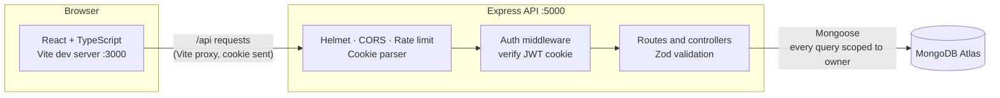
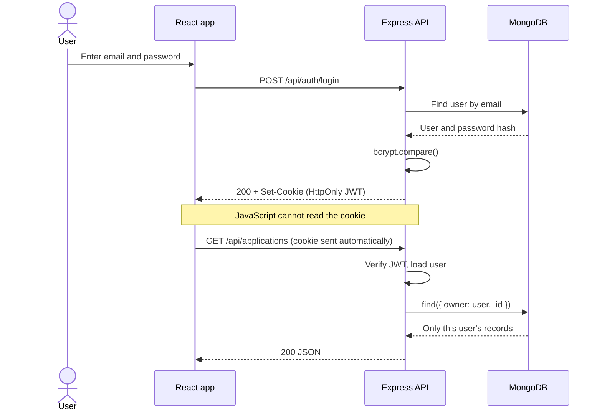
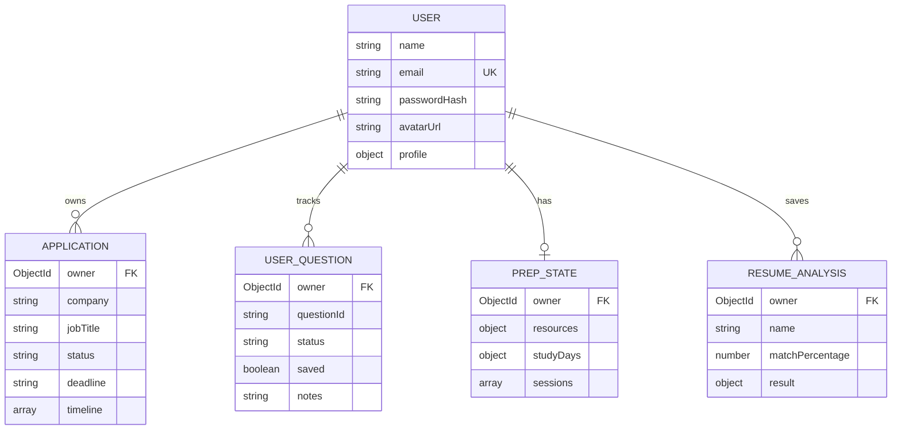

<div align="center">

# Internly

**Track internship applications, check your resume against job descriptions, and prepare for interviews, all in one place.**


</div>

## Why I built this

Applying for internships means juggling dozens of deadlines, resume versions and interview prep notes across spreadsheets and tabs. Internly puts the whole pipeline in one workspace, with real accounts, so every student's data is private and persistent.

## Features

| | |
| --- | --- |
| **Application tracker** | Add, edit, delete, search, filter and sort. Table and Kanban views, plus an activity timeline per application |
| **Dashboard** | Pipeline summary, upcoming deadlines and recent activity |
| **Resume checker** | Keyword alignment against a job description, with suggestions, a checklist and saved reports. Analysis runs in the browser, so resume text is never uploaded |
| **Interview prep** | Question library with personal status, bookmarks, notes and practice answers. Custom questions, study plan, resources and timed mock sessions |
| **Analytics** | Response, interview and offer rates, charts, and interview-prep progress |
| **Profile and settings** | Career profile, photo upload and tracker preferences |
| **Secure accounts** | bcrypt password hashing, HttpOnly cookie sessions, per-user data isolation |

## Screenshots

| Applications | Kanban |
| --- | --- |
|  |  |

| Interview prep | Resume checker |
| --- | --- |
|  |  |

| Analytics | Profile |
| --- | --- |
|  |  |

## Architecture



## Authentication flow



## Data model



## Security

- Passwords are stored only as bcrypt hashes
- The session token is an HttpOnly cookie, unreadable by page scripts
- Every query is filtered by the signed-in user, so one user can never read or change another's data (a wrong id returns 404)
- All input is validated with Zod on the server, with length and format limits
- Uploaded photos are checked by file signature, size-limited, and SVG is rejected
- Login and registration are rate limited
- Secrets live in environment variables and are never committed

## Tech stack

| Layer | Tools |
| --- | --- |
| Frontend | React 19, TypeScript, Vite, Tailwind CSS v4, Recharts, Lucide |
| Backend | Node.js, Express 5, Mongoose |
| Database | MongoDB Atlas |
| Auth and safety | bcryptjs, jsonwebtoken, Zod, Helmet, express-rate-limit |

## Project structure

```
internly/
├── src/                      # React frontend
│   ├── components/           # Pages, layout, modals
│   ├── services/             # API client and service modules
│   ├── hooks/                # Data hooks
│   ├── utils/                # Analytics, dates, resume matching
│   └── data/                 # Interview question library
└── server/
    └── src/
        ├── config/           # Database connection
        ├── controllers/      # Request handlers
        ├── middleware/       # Auth protection
        ├── models/           # Mongoose schemas
        ├── routes/           # Express routers
        └── utils/            # Tokens, validation
```

## Getting started

**Prerequisites:** Node.js 20.19+ and a free [MongoDB Atlas](https://www.mongodb.com/atlas) cluster.

```bash
git clone https://github.com/YOURUSERNAME/internly.git
cd internly
npm install
cd server && npm install
```

Create `server/.env` (copy `server/.env.example`) and fill it in:

```
PORT=5000
NODE_ENV=development
CLIENT_URL=http://localhost:3000
MONGODB_URI=your-atlas-connection-string-ending-in-/internly
JWT_SECRET=a-long-random-string
```

Generate a secret with `node -e "console.log(require('crypto').randomBytes(48).toString('hex'))"`.

Run both servers in two terminals:

```bash
# Terminal 1: API (from /server)
npm run dev

# Terminal 2: frontend (from the project root)
npm run dev
```

Open http://localhost:3000. Health check: http://localhost:5000/api/health.

## API overview

| Area | Endpoints |
| --- | --- |
| Auth | `POST /api/auth/register` · `login` · `logout` · `GET /api/auth/me` |
| Applications | `GET/POST /api/applications` · `GET/PUT/DELETE /api/applications/:id` |
| Profile | `GET/PUT /api/profile` · `PUT/DELETE /api/profile/avatar` |
| Interview prep | `GET /api/interview` plus progress, custom questions, resources, study days, sessions |
| Resume reports | `GET/POST /api/resume-analyses` · `GET/DELETE /api/resume-analyses/:id` |

All routes except register and login need a signed-in session.

## Roadmap

- [x] Authentication and per-user data
- [x] Applications, interview prep, resume reports, analytics
- [ ] Password reset by email
- [ ] Automated API tests
- [ ] Deployment guide and live demo
- [ ] Email verification

## License

MIT
